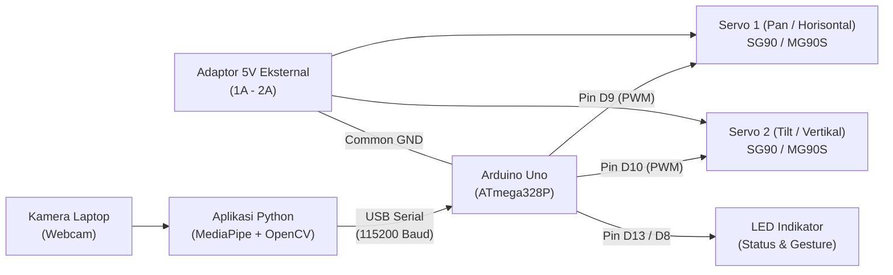

# Skema Rangkaian & Panduan Wiring

## 1. Diagram Blok Sistem



---

## 2. Tabel Sambungan Pin (Wiring Pinout)

### A. Servo Motor (Pan & Tilt)

| Komponen | Kabel Servo | Pin Arduino / Power | Keterangan |
| :--- | :--- | :--- | :--- |
| **Servo Pan** (Horizontal) | **Orange / Kuning** (Signal) | **Pin D9 (PWM)** | Sinyal kendali sudut Pan (10° - 170°) |
| | **Merah** (VCC / Power) | **+5V Eksternal** *(Disarankan)* | Catu daya motor servo |
| | **Coklat / Hitam** (GND) | **GND Eksternal & GND Arduino** | **Wajib Common Ground!** |
| **Servo Tilt** (Vertikal) | **Orange / Kuning** (Signal) | **Pin D10 (PWM)** | Sinyal kendali sudut Tilt (35° - 145°) |
| | **Merah** (VCC / Power) | **+5V Eksternal** *(Disarankan)* | Catu daya motor servo |
| | **Coklat / Hitam** (GND) | **GND Eksternal & GND Arduino** | **Wajib Common Ground!** |

### B. Indikator LED

| Indikator | Posisi | Pin Arduino | Keterangan |
| :--- | :--- | :--- | :--- |
| **LED Status Bawaan** | Board Arduino Uno | **Pin D13 (Built-in)** | Menyala stabil = Serial terkoneksi normal |
| **LED Gesture** *(Opsional)* | Breadboard eksternal | **Pin D8** (melalui resistor 220Ω ke Anoda) | Berkedip sesuai respon gesture tangan |

---

## 3. Catatan Penting Mengenai Catu Daya (Power Supply)

> [!CAUTION]
> **JANGAN memberi daya 2 servo sekaligus langsung dari pin 5V Arduino Uno!**
> 
> Motor servo SG90/MG90S dapat menarik arus puncak (*stall current*) hingga **500mA - 1000mA per motor** saat bergerak mendadak. Pin regulator 5V Arduino Uno hanya mampu menyuplai sekitar 400-500mA total.
> 
> Jika dihubungkan langsung ke 5V Arduino:
> 1. Arduino akan mengalami **Brown-Out Reset** (board me-restart sendiri secara berulang-ulang).
> 2. Komunikasi Serial USB ke laptop akan terputus mendadak (*Connection Lost*).
> 
> **Solusi:**
> Gunakan adaptor 5V (2A) atau power bank terpisah untuk kabel merah servo, dan **hubungkan kabel hitam/ground adaptor ke GND Arduino Uno** (Common Ground).

---

## 4. Diagram Rangkaian ASCII

```text
    +-----------------------------------------------+
    |              ARDUINO UNO                     |
    |                                               |
    |  [D10] PWM ------------------+ (Kabel Kuning) |
    |  [D9]  PWM ---------+        |                |
    |  [GND] -------------|---+    |                |
    +---------------------|---|----|----------------+
                          |   |    |
                          |   |    |
          +---------------+   |    +---------------+
          |                   |                    |
          v                   v                    v
     [Sinyal D9]           [GND]              [Sinyal D10]
     +---------+        +---------+           +---------+
     | SERVO 1 |        |  COMMON |           | SERVO 2 |
     |  (PAN)  |        |  GROUND |           | (TILT)  |
     +---------+        +---------+           +---------+
          ^                   ^                    ^
          | (Kabel Merah)     | (Kabel Hitam)      | (Kabel Merah)
          +----------+        |        +-----------+
                     |        |        |
                     +--------+--------+
                              |
                    +--------------------+
                    |  ADAPTOR 5V (2A)   |
                    |  +5V (Merah)       |
                    |  GND (Hitam)       |
                    +--------------------+
```
