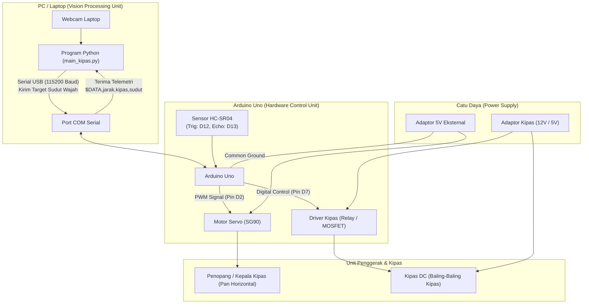

# Skema Rangkaian & Panduan Integrasi Kipas Otomatis

Panduan ini melengkapi file [panduan_arsitektur_sistem_kipas_otomatis_dengan_pendeteksi_wajah_dan_jarak.md](file:///c:/Users/David/Documents/adruido/panduan_arsitektur_sistem_kipas_otomatis_dengan_pendeteksi_wajah_dan_jarak.md) dengan konfigurasi pin aktual yang sudah disesuaikan dengan sketsa Arduino [arduino/kipas_otomatis/kipas_otomatis.ino](file:///c:/Users/David/Documents/adruido/arduino/kipas_otomatis/kipas_otomatis.ino) dan dasar pin dari `contoh.txt`.

---

## 1. Analisis Kesalahan pada Kode Dasar (`contoh.txt`)

Pada file `contoh.txt` sebelumnya, terdapat beberapa kesalahan dan keterbatasan logika yang membuatnya belum bisa menjalankan skema sistem:

| No | Masalah pada `contoh.txt` | Dampak | Perbaikan pada `kipas_otomatis.ino` |
|:---|:---|:---|:---|
| 1 | **Tidak ada pin & logika untuk Kipas DC** | Kipas tidak pernah bisa menyala/mati secara otomatis. | Ditambahkan `FAN_PIN = 7`, `pinMode(FAN_PIN, OUTPUT)`, dan fungsi kendali relay/MOSFET `aturStatusKipas()`. |
| 2 | **Tidak ada pembacaan Serial dari PC** | Sudut servo tidak bisa diarahkan oleh deteksi wajah dari webcam. | Ditambahkan parser serial non-blocking `bacaSerialInput()` yang membaca target sudut dari PC via USB. |
| 3 | **Servo bergerak sendiri (*Sweep Manual*)** | Servo hanya bolak-balik 75°-105° sendiri bukannya melacak posisi wajah pengguna. | Posisi servo dikendalikan secara presisi oleh koordinat wajah hasil pemrosesan Computer Vision di PC. |
| 4 | **Ambang batas jarak terlalu sempit (<= 10 cm)** | Kipas hanya merespon jika pengguna berada sangat dekat (< 10 cm). | Diubah menjadi `AMBANG_BATAS_JARAK = 50.0 cm` (dapat disesuaikan) dengan *off-delay hysteresis* 2.5 detik agar tidak berkedip mati-nyala. |
| 5 | **Serial Flooding (`Serial.println` setiap loop)** | Port Serial macet karena dibanjiri string teks tanpa jeda waktu. | Menggunakan sistem telemetri periodik (setiap 300 ms) via `millis()`. |
| 6 | **Fungsi Blocking (`delay(20)` & `pulseIn(..., 30000)`)** | Loop tersendat-sendat (*lag*), menyebabkan servo bergerak patah-patah (*jitter*). | Seluruh penjadwalan menggunakan pewaktu `millis()` non-blocking dengan timeout pulseIn yang aman. |
| 7 | **Pulse width `attach(SERVO_PIN, 1000, 2000)`** | Rentang fisik putaran servo terpotong menjadi sempit. | Menggunakan standar kalibrasi SG90 `attach(SERVO_PIN, 544, 2400)` untuk rentang gerak 0° - 180° penuh. |

---

## 2. Diagram Blok Rangkaian

---

## 3. Matriks Sambungan Kabel (Pinout Table)

### A. Sensor Ultrasonik HC-SR04
| Pin Modul | Terhubung ke | Keterangan |
|:---|:---|:---|
| **VCC** | Pin 5V Arduino | Jalur daya 5V |
| **GND** | Pin GND Arduino | Ground bersama |
| **TRIG** | **Pin D12 Arduino** | Output pemicu pulsa ultrasonik |
| **ECHO** | **Pin D13 Arduino** | Input penerima pantulan gelombang |

### B. Motor Servo (Penggerak Arah Kipas)
| Kabel Servo | Warna Umum | Terhubung ke | Catatan Penting |
|:---|:---|:---|:---|
| **Signal** | Kuning / Oranye | **Pin D2 Arduino** | Sinyal kendali sudut (Timer1 PWM) |
| **VCC (+)** | Merah | **+5V Adaptor Eksternal** | *Sangat disarankan daya eksternal (1A-2A)* |
| **GND (-)** | Coklat / Hitam | **GND Adaptor & GND Arduino** | **Wajib Common Ground!** |

> [!WARNING]
> Jangan menyuplai arus motor servo langsung dari pin 5V Arduino jika servo beroperasi dengan beban baling-baling/kipas, karena lonjakan arus (*stall current*) dapat me-reset Arduino secara tiba-tiba (*brown-out reset*).

### C. Driver Kipas DC (Relay Module / Transistor / MOSFET)
| Pin Modul Driver | Terhubung ke | Keterangan |
|:---|:---|:---|
| **IN / SIG** | **Pin D7 Arduino** | Sinyal ON/OFF dari Arduino |
| **VCC** | Pin 5V Arduino | Daya pengaktif koil relay |
| **GND** | Pin GND Arduino | Ground sistem |
| **Terminal COM (Common)** | Kutub (+) Adaptor Kipas | Saklar daya jalur positif kipas |
| **Terminal NO (Normally Open)** | Kabel (+) Kipas DC | Terhubung ke kutub positif kipas |
| **Kabel (-) Kipas DC** | Kutub (-) Adaptor Kipas | Ground daya kipas |

---

## 4. Cara Menjalankan Sistem

### Langkah 1: Upload Program ke Arduino
1. Buka aplikasi **Arduino IDE**.
2. Buka file sketsa:
   `arduino/kipas_otomatis/kipas_otomatis.ino`
3. Pilih board **Arduino Uno** dan port COM yang sesuai di Arduino IDE.
4. Klik tombol **Upload** (panah kanan) dan tunggu hingga selesai (`Done uploading`).

### Langkah 2: Jalankan Program Python di Komputer
1. Pastikan webcam laptop tidak sedang dibuka oleh aplikasi lain (seperti Zoom / Teams).
2. Double-click file:
   `run_kipas.bat`
   *(atau jalankan via terminal: `.\.venv\Scripts\python.exe python\main_kipas.py`)*
3. Jendela visual (*HUD*) akan terbuka:
   - Wajah Anda akan dideteksi dan diberi tanda kotak hijau/kuning.
   - Posisi kepala yang bergeser ke kiri/kanan akan langsung memutar sudut servo penopang kipas.
   - Jika jarak Anda terhadap sensor HC-SR04 berada $\le 50\text{ cm}$, indikator kipas di layar akan berubah menjadi **NYALA (ON)** dan relay akan menghidupkan kipas DC.
